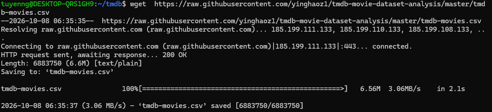
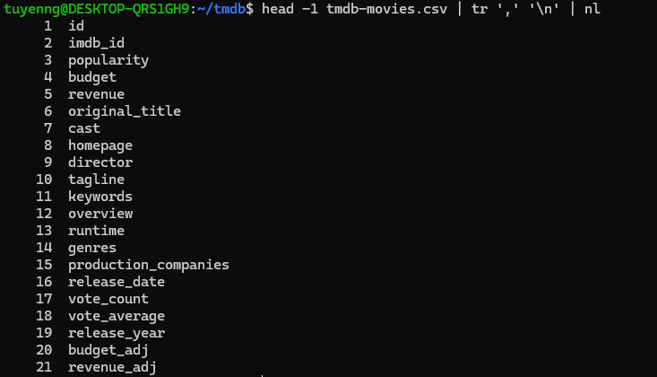
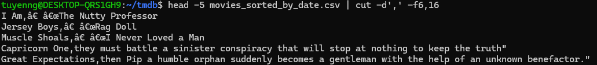

# TMDB Movie Analysis with the Linux Command Line

Answering 8 questions about 10,866 movies using only shell tools, and documenting the silent bugs found along the way.

| | |
|---|---|
| **Script** | [`src/tmdb_analysis.sh`](src/tmdb_analysis.sh) |
| **Data** | [tmdb-movies.csv](https://raw.githubusercontent.com/yinghaoz1/tmdb-movie-dataset-analysis/master/tmdb-movies.csv) (10,866 movies, 21 columns) |
| **Tools** | `wget`, Miller (`mlr`), `awk`, `sort`, `cut`, `tr`, `uniq`, `grep` |
| **Environment** | Ubuntu on WSL |

This README shows the **process** that led to the final script, including the bugs I hit, how I found them and how I fixed them. The final answers are in [section 3](#3-final-results-q1q7).

## Contents

1. [How to run](#1-how-to-run)
2. [Process and bugs](#2-process-and-bugs)
3. [Final results (Q1–Q7)](#3-final-results-q1q7)
4. [Q8 – Idea: data quality analysis](#4-q8--idea-data-quality-analysis)
5. [Next step: automation](#5-next-step-automation)
6. [Lessons learned](#6-lessons-learned)

---

## 1. How to run

From this folder:
```bash
sudo apt install miller          # a real CSV reader, used in the cleaning step
bash src/tmdb_analysis.sh
```

The script downloads the data itself, so the original CSV is not stored in this repository. The steps inside the script:

```
Download (wget) → Clean (mlr CSV → TSV) → Check column counts → Q1–Q8
```

The check step prints the number of columns per line. The correct result is `10867 21`: every line has 21 columns. Result files are written to `output/`.

---

## 2. Process and bugs

### Step 1 – Download and explore the data

```bash
mkdir -p ~/tmdb && cd ~/tmdb
wget https://raw.githubusercontent.com/yinghaoz1/tmdb-movie-dataset-analysis/master/tmdb-movies.csv
ls -lh                                          # 6.6M → real data, not an error page
head -1 tmdb-movies.csv | tr ',' '\n' | nl      # number the columns
wc -l tmdb-movies.csv                           # 10879 lines
```




Columns used throughout: `4 budget · 5 revenue · 6 original_title · 7 cast · 9 director · 14 genres · 16 release_date · 17 vote_count · 18 vote_average · 19 release_year`

---

### Bug 1 – Splitting on commas gives the wrong columns

**Symptom.** The first attempt at Q1:

```bash
sort -t',' -k16,16r tmdb-movies.csv > movies_sorted_by_date.csv
head -5 movies_sorted_by_date.csv | cut -d',' -f6,16
```

Column 16 should be `release_date`, but it showed pieces of movie descriptions, for example `Capricorn One,they must battle a sinister conspiracy…`. **No error message, just wrong output.**



Check: count the columns on each line.

```bash
awk -F',' '{print NF}' tmdb-movies.csv | sort -n | uniq -c
grep 'Capricorn One' tmdb-movies.csv | awk -F',' '{print NF}'    # 25 instead of 21
```

Only 1,706 / 10,879 lines have exactly 21 columns.

Cause:

- Text columns (overview, tagline, cast, title) contain commas inside quotes `"..."`. `cut`, `sort` and `awk` don't understand quotes, so they split in the wrong places.
- Some overviews contain line breaks, so one movie is split across two lines. That's why the line count (10,879) differs from the movie count (10,866).

Fix: use Miller to read the CSV correctly and convert it to TSV (tab-separated).

```bash
mlr --icsv --otsv cat tmdb-movies.csv > tmdb.tsv
awk -F'\t' '{print NF}' tmdb.tsv | sort -n | uniq -c     # 10867 21: every line has 21 columns
```

From here on, every question uses `tmdb.tsv`. The original CSV is kept unchanged.

---

### Bug 2 – Dates sorted as text (Q1)

Symptom: after sorting, the first lines were 9/9/97, 9/9/96, 9/9/94, not 2015 movies.

```bash
sort -t$'\t' -k16,16r tmdb.tsv > movies_sorted_by_date.tsv
```

Cause: dates are in m/d/yy format. `sort` compares character by character from the left, so 9/9/97 comes before 12/31/15 because 9 is greater than 1.

Fix: build a YYYYMMDD key (taking the year from the `release_year` column), sort by that key, then remove it. The header line is written separately.

```bash
head -1 tmdb.tsv > movies_sorted_by_date.tsv
tail -n +2 tmdb.tsv | awk -F'\t' '{ split($16, d, "/"); printf "%04d%02d%02d\t%s\n", $19, d[1], d[2], $0 }' | sort -t$'\t' -k1,1r | cut -f2- >> movies_sorted_by_date.tsv
```

---

### Bug 3 – Revenue = 0 is missing data (Q3)

Symptom: the 3 movies with the lowest revenue all had revenue = 0.

```bash
awk -F'\t' '$1 == 0' revenue_sorted.tsv | wc -l     # 6016 movies
awk -F'\t' '$1 > 0'  revenue_sorted.tsv | head -5   # the lowest values after removing 0
```

Finding: 0 means nobody entered the data. After removing the zeros, the lowest value is $2 (Mallrats). In reality this movie made about $2 million, so the unit was most likely entered wrongly.

Handling: exclude movies with revenue = 0 and state this assumption in the answer.

---

### Bug 4 – Empty values and several names in one cell (Q6, Q7)

Symptom: in the director ranking, rank 2 was a line with no name (44 movies have no director).

```bash
cut -f9 tmdb.tsv | tail -n +2 | sort | uniq -c | sort -nr | head -5
```

A mistake while fixing it: I put `grep -v '^$'` at the start of the command, so the result didn't change and the terminal hung. `grep` had no input file, so it waited for keyboard input. The empty lines only appear after `cut -f9` runs, so `grep` has to come after `cut`.

Also, some movies have several directors in one cell (`A|B`), which were counted as one person.

Fix: split the names with `tr`, remove empty lines, then count.

```bash
cut -f9 tmdb.tsv | tail -n +2 | tr '|' '\n' | grep -v '^$' | sort | uniq -c | sort -nr | head -5
```

Result after the fix: Woody Allen is still first (46 movies, previously 45), the empty line is gone, and Martin Scorsese (31) moved above Steven Spielberg (30).

The same approach works for actors (column 7) and genres (column 14); only the column number changes.

---

## 3. Final results (Q1–Q7)

**Q1. Sort movies by release date, newest first**

- Output: `output/movies_sorted_by_date.tsv`
- Newest movie: 31 Dec 2015
- Same number of lines as the input (10,867), so no lines were lost

**Q2. Movies with an average rating above 7.5**

- Output: `output/movies_rating_above_7_5.tsv`, 350 movies
- Lowest rating in the result: 7.6

**Q3. Highest and lowest revenue**

- Highest: Avatar, $2,781,505,847
- Lowest: Mallrats and Shattered Glass, $2
- Note: movies with revenue = 0 (missing data) are excluded. The $2 value is most likely a unit error.

**Q4. Total revenue of all movies**

- $432,720,192,875 (about $432.7 billion)
- Note: nominal values, not adjusted for inflation. About 55% of movies have no revenue, so the real total is higher.

**Q5. Top 10 movies by profit**

1. Avatar: $2.54B
2. Star Wars: The Force Awakens: $1.87B
3. Titanic: $1.65B
4. Jurassic World: $1.36B
5. Furious 7: $1.32B
6. The Avengers: $1.30B
7. Harry Potter and the Deathly Hallows: Part 2: $1.20B
8. Avengers: Age of Ultron: $1.13B
9. Frozen: $1.12B
10. The Net: $1.08B

Note: only movies with both budget and revenue greater than 0.

**Q6. Director and actor with the most movies**

- Director: Woody Allen, 46 movies
- Actor: Robert De Niro, 72 movies (followed by Samuel L. Jackson, 71)
- Note: movies with several directors count for each of them; empty values are excluded. The `cast` column lists only the main actors.

**Q7. Number of movies per genre**

| Genre | Movies |
|---|---|
| Drama | 4,761 |
| Comedy | 3,793 |
| Thriller | 2,908 |
| Action | 2,385 |
| Romance | 1,712 |
| Horror | 1,637 |
| Adventure | 1,471 |
| Crime | 1,355 |
| Family | 1,231 |
| Science Fiction | 1,230 |
| Fantasy | 916 |
| Mystery | 810 |
| Animation | 699 |
| Documentary | 520 |
| Music | 408 |
| History | 334 |
| War | 270 |
| Foreign | 188 |
| TV Movie | 167 |
| Western | 165 |

Note: a movie can belong to several genres, so the counts overlap. 23 movies have no genre.

---

## 4. Q8 – Idea: data quality analysis

This idea comes from the bugs above: before analysing further, measure how far the data can be trusted. Problems found during the project:

| # | Problem | How many | Found in | Impact |
|---|---|---|---|---|
| 1 | Commas inside quoted text | 9,173 / 10,879 lines split wrongly on commas | Bug 1 | Shifted columns, no error |
| 2 | Line breaks inside the overview column | 10,879 lines but only 10,866 movies | Bug 1 | Line count ≠ movie count |
| 3 | Date format m/d/yy | every line | Bug 2 | Can't be sorted as text; 2-digit year has no century |
| 4 | Revenue = 0 (missing data) | 6,016 movies | Bug 3 | Total revenue lower than reality |
| 5 | Empty director or genre | 44 without director, 23 without genre | Bug 4, Q7 | An "empty" group in rankings |
| 6 | Broken characters (mojibake), e.g. `“` | — | Output of Bug 1 | Text displays incorrectly |

**Why is this data wrong?** Possibly:

- At manual entry: wrong unit typed (revenue $2), director and genre left empty.
- At save and export: empty values written as 0, encoding errors, dates as m/d/yy.

The shifted columns (Bug 1) are caused by how the file was read, not by the data itself.

**Applying Lean and Kaizen to reduce errors**

- **Pareto:** fix the most frequent problem first: revenue = 0.
- **5 Whys:** revenue $2 → the person entering it thought the unit was millions → the form shows no unit and has no check.
- **Poka-yoke:** prevent errors at entry (show the USD unit, warn on unusual values, leave empty instead of entering 0).
- **Jidoka:** the pipeline stops itself when the data is broken, instead of producing a wrong report.
- **Kaizen (PDCA):** rerun the quality report after every data update to see whether the error count goes down.

**Other analysis ideas for later**

- Movies per year, to see trends in the film industry
- Average rating per genre
- ROI (revenue / budget) per genre
- Ask people with domain knowledge which KPIs matter

---

## 5. Next step: automation

- Make the script stop itself when the data is broken, so it never produces a wrong report.
- Use `cron` to run the script automatically every day, for example at 6 AM.

---

## 6. Lessons learned

1. **Check the delimiter before trusting any column:** `awk -F',' '{print NF}' file | sort -n | uniq -c`. A clean file gives exactly one line.
2. **The most dangerous bugs are silent.** Every bug in this project produced output _without any error message_.
3. **Clean the data once (convert to `tmdb.tsv`), keep the original, and check after every step.**
4. **Use the right tool for the format:** a real CSV reader for CSV files.
5. **Dates must be in ISO form (`YYYYMMDD`) to sort correctly.** Handle the header separately.
6. **0 doesn't always mean zero.** Check what a value means before using it.
7. **Pipes run left to right.** A filter only acts on the data that reaches it.
8. **A good answer = the number + the assumptions + the limits.**
9. **Go straight into the project.**

## Project structure

```
01-tmdb-cli-analysis/
├── README.md
├── docs/
│   └── images/          # screenshots used in this README
└── src/
    └── tmdb_analysis.sh # the full pipeline: download, clean, Q1–Q8
```

Not in Git: the downloaded `tmdb-movies.csv`, the cleaned `tmdb.tsv` and the `output/` folder. The script recreates them.
